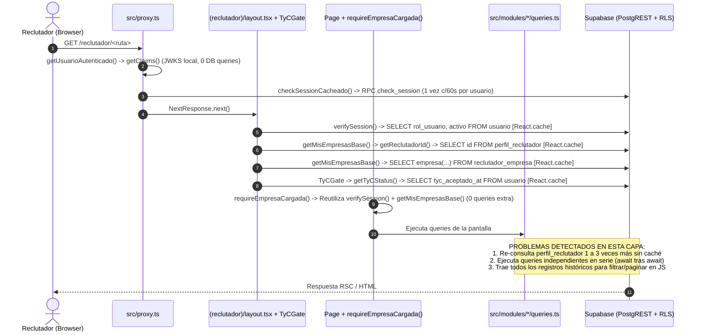

# SPEC TÉCNICA — Auditoría de Performance y Plan de Optimización (Zona del Reclutador)

- **Proyecto:** MiLiors
- **Alcance:** Zona del Reclutador (`src/app/(reclutador)/reclutador/**` y módulos asociados en `src/modules/**`, `src/lib/**`, `supabase/migrations/**`)
- **Fecha:** 27 de Octubre de 2026
- **Estado:** Propuesta técnica para revisión (Fase 1 — Diagnóstico y Especificación de Cambios)

---

## Índice

1. [A. Resumen Ejecutivo](#a-resumen-ejecutivo)
2. [B. Mapa del Acceso a Datos](#b-mapa-del-acceso-a-datos)
3. [C. Tabla Consolidada de Hallazgos (F-01 a F-12)](#c-tabla-consolidada-de-hallazgos-f-01-a-f-12)
4. [D. Especificación Detallada de Hallazgos y Soluciones (Evidencia Punto por Punto)](#d-especificación-detallada-de-hallazgos-y-soluciones-evidencia-punto-por-punto)
   - [F-01 (P0): Escaneo global de `historial_puesto` en `registrarApertura`](#f-01-p0--crítico-escaneo-global-de-historial_puesto-en-registrarapertura)
   - [F-02 (P1): Falta de validación de propiedad con `service_role` + Cascada de 3 Server Actions en `MarcaPostulacionBtns`](#f-02-p1--alto-falta-de-validación-de-propiedad-con-service_role--cascada-de-3-server-actions-en-marcapostulacionbtns)
   - [F-03 (P1): Sobrecarga, cascada secuencial y reutilización abusiva de `getPostulacionesRecibidas`](#f-03-p1--alto-sobrecarga-cascada-secuencial-y-reutilización-abusiva-de-getpostulacionesrecibidas)
   - [F-04 (P1): Descarga sin paginación en `buscarPostulantes`, filtrado de competencias en JS y bloqueo RLS en `test_eneagrama`](#f-04-p1--alto-descarga-sin-paginación-en-buscarpostulantes-filtrado-de-competencias-en-js-y-bloqueo-rls-en-test_eneagrama)
   - [F-05 (P1): Waterfall de 15 consultas en 9 etapas secuenciales en `PostulanteDetallePage`](#f-05-p1--alto-waterfall-de-15-consultas-en-9-etapas-secuenciales-en-postulantedetallepage)
   - [F-06 (P1): Consultas repetidas a `perfil_reclutador` y `usuario` dentro del mismo request](#f-06-p1--alto-consultas-repetidas-a-perfil_reclutador-y-usuario-dentro-del-mismo-request)
   - [F-07 (P2): Bucle N+1 de `INSERT` secuenciales en `persistirFormularioPreselector` y re-escritura innecesaria al editar puesto](#f-07-p2--medio-bucle-n1-de-insert-secuenciales-en-persistirformulariopreselector-y-re-escritura-innecesaria-al-editar-puesto)
   - [F-08 (P2): Doble consulta a `historial_puesto`, sobre-selección de columnas y filtrado de ciclos en memoria en `MisPuestos` y `MisEmpresas`](#f-08-p2--medio-doble-consulta-a-historial_puesto-sobre-selección-de-columnas-y-filtrado-de-ciclos-en-memoria-en-mispuestos-y-misempresas)
   - [F-09 (P2): Doble consulta a `puesto` y cascada secuencial en `getDashboardMetrics`](#f-09-p2--medio-doble-consulta-a-puesto-y-cascada-secuencial-en-getdashboardmetrics)
   - [F-10 (P2): `SELECT DISTINCT` en memoria en `getCarrerasOtras` y catálogos estáticos sin caché](#f-10-p2--medio-select-distinct-en-memoria-en-getcarrerasotras-y-catálogos-estáticos-sin-caché)
   - [F-11 (P2): Índices compuestos faltantes, búsquedas Regex `~*` y subconsultas RLS sin `InitPlan`](#f-11-p2--medio-índices-compuestos-faltantes-búsquedas-regex--y-subconsultas-rls-sin-initplan)
   - [F-12 (P3): Llamadas secuenciales evitables en `EditarPuestoPage` y `PuestoDetallePage`](#f-12-p3--bajo-llamadas-secuenciales-evitables-en-editarpuestopage-y-puestodetallepage)
5. [E. Oportunidades de Caché y Matriz de Aislamiento Multi-Tenant](#e-oportunidades-de-caché-y-matriz-de-aislamiento-multi-tenant)
6. [F. Especificación de SQL, RLS e Índices](#f-especificación-de-sql-rls-e-índices)
7. [G. Plan de Optimización Priorizado por Etapas](#g-plan-de-optimización-priorizado-por-etapas)
8. [H. Plan de Medición y Validación (Antes vs. Después)](#h-plan-de-medición-y-validación-antes-vs-después)
9. [I. Orden Recomendado de Implementación y Checklist de Corroboración](#i-orden-recomendado-de-implementación-y-checklist-de-corroboración)

---

## A. Resumen Ejecutivo

### 1. Arquitectura y Stack Auditado
- **Frontend / SSR:** Next.js `16.2.9` (App Router) + React `19.2.4` (Server Components y Server Actions).
- **Acceso a Datos:** `@supabase/ssr` (`0.10.2`) y `@supabase/supabase-js` (`2.103.3`).
- **Naturaleza del cliente de base de datos:** La aplicación **no utiliza un ORM con conexión TCP persistente** (como Prisma o Drizzle). Cada llamada `supabase.from(...)` o `supabase.rpc(...)` dispara una **petición HTTP REST sobre PostgREST** hacia Supabase, donde PostgreSQL evalúa políticas de **Row Level Security (RLS)** en cada sentencia.
- **Factor crítico de latencia:** En este stack, el cuello de botella principal es el **número de roundtrips HTTP secuenciales (waterfalls)** entre el servidor de Next.js y PostgREST, el **volumen de filas y columnas transferidas sin paginar** para ser filtradas en JavaScript, y la **evaluación repetida de subconsultas en políticas RLS**.

### 2. Optimizaciones ya Existentes en el Proyecto (Que se Mantienen Intactas)
1. **Verificación local de JWT (`getClaims`):** En `src/lib/supabase/claims.ts:25-33`, `getUsuarioAutenticado()` valida la firma ES256 localmente contra el endpoint JWKS cacheado, sin hacer un roundtrip a `auth.getUser()`.
2. **Caché en memoria de actividad de sesión (`checkSessionCacheado`):** En `src/lib/session/check-session-cache.ts:30-52`, el middleware (`src/proxy.ts:78`) cachea en un `Map` en memoria por 60 segundos el resultado del RPC `check_session`, evitando ejecutar un `SELECT + UPDATE` en `sesion_actividad` en cada request.
3. **Uso inicial de `React.cache()`:** `verifySession`, `getSessionUser`, `getTyCStatus` (`src/lib/dal.ts`) y `getReclutadorId`, `getMisEmpresasBase` (`src/modules/empresas/queries.ts:26-55`) ya emplean `cache()` para deduplicar llamadas dentro del mismo renderizado RSC.

### 3. Principales Problemas Confirmados en el Código
1. **Escaneo de tabla completa en `registrarApertura` (`P0`):** Al publicar o reactivar un puesto, `src/modules/puestos/actions.ts:96-109` descarga **todos los registros de `historial_puesto` del último año de todas las empresas de la plataforma** usando el cliente `service_role`, para filtrar en memoria JS por `empresa_id` y `titulo_puesto`.
2. **Autorización incompleta con `service_role` + Cascada de 3 Server Actions por clic (`P1`):** En `src/modules/postulaciones/actions.ts:292-400`, `avanzarEstadoPostulacion`, `revertirDescarte` y `marcarPostulacion` consultan `perfil_reclutador` pero **nunca verifican que la postulación pertenezca a un puesto de ese reclutador** antes de actualizar con `createAdminClient()`. Además, en `src/components/shared/marca-postulacion.tsx:81-143`, un clic en "No avanzar" con motivo ejecuta **3 Server Actions en serie**, provocando 3 ciclos completos de `revalidatePath('/reclutador/postulaciones')`.
3. **Abuso de la megaconsulta `getPostulacionesRecibidas` (`P1`):** `src/modules/puestos/queries.ts:695-852` trae todas las postulaciones históricas y actuales sin paginar, encadena 3 consultas independientes de forma secuencial (`historial_puesto` → `nota_privada` → `perfil_tecnico`), envía UUIDs duplicados en `.in('postulante_id', postulanteIds)` y es invocada completa en `PuestoAsistentePage` (para filtrar 1 puesto en JS) y en `MisNotasPage` (solo para obtener títulos de puestos).
4. **Buscador de candidatos sin paginación en SQL y con fallo silencioso de RLS (`P1`):** `buscarPostulantes` (`src/modules/postulantes/queries.ts:59-161`) descarga todos los perfiles con `perfil_en_busqueda = true`, consulta las competencias de todos en un `.in()` masivo (que romperá el límite de URL HTTP con ~300+ postulantes), filtra competencias en memoria y pagina en memoria. Además, hace join con `test_eneagrama` usando el cliente del reclutador, pero la política RLS `test_eneagrama_select` (`supabase/migrations/002_rls.sql:449-458`) bloquea a los reclutadores, devolviendo siempre nulo tras evaluar RLS fila por fila.
5. **Waterfall de hasta 15 consultas en 9 etapas secuenciales en `PostulanteDetallePage` (`P1`):** Al abrir `/reclutador/postulantes/[id]?postulacion=X`, `getPostulanteDetalle` y la página encadenan 9 rondas secuenciales de consultas HTTP a Supabase.
6. **Re-ejecución de `SELECT id FROM perfil_reclutador` de 2 a 4 veces por pantalla (`P1`):** Los módulos `dashboard`, `puestos`, `postulantes` y `asistente` no reutilizan `getReclutadorId()` (que ya fue ejecutado por el Layout) y vuelven a consultar `perfil_reclutador` en cada función.

---

## B. Mapa del Acceso a Datos

### 1. Diagrama del Ciclo de Vida de Petición en la Zona del Reclutador



### 2. Conteo Exacto de Consultas por Pantalla / Operación

> **Nota sobre la columna "Base Layout/Guard":** Toda página dentro de `src/app/(reclutador)/` ejecuta en el Layout y Guards 4 consultas base cacheadas por request:
> 1. `verifySession()` → `usuario` (`src/lib/dal.ts:28`)
> 2. `getTyCStatus()` → `usuario` (`src/lib/dal.ts:74`)
> 3. `getReclutadorId()` → `perfil_reclutador` (`src/modules/empresas/queries.ts:29`)
> 4. `getMisEmpresasBase()` → `reclutador_empresa` + `empresa` (`src/modules/empresas/queries.ts:45`)

| Pantalla / Acción | Ruta / Archivo | Queries Base | Queries Propias | Total Actual | Meta Optimizada | Detalle de Consultas Redundantes Actuales |
| :--- | :--- | :---: | :---: | :---: | :---: | :--- |
| **Dashboard** | `reclutador/page.tsx` + `metricas-section.tsx` | 4 | 6 | **10** | **6** | `perfil_reclutador` se consulta 3 veces en total (Layout, `page.tsx:18`, `dashboard/queries.ts:69`); `puesto` se consulta 2 veces en `dashboard/queries.ts:79` y `L111`. |
| **Mis Empresas** | `reclutador/empresas/page.tsx` | 4 | 3 | **7** | **6** | `getMisEmpresas` consulta `puesto` → `historial_puesto` → `postulacion` (trayendo postulaciones de todos los ciclos en vez de filtrar por `historial_puesto_id`). |
| **Mis Puestos** | `reclutador/puestos/page.tsx` | 4 | 4 | **8** | **5** | `getMisPuestos` re-consulta `perfil_reclutador` (`L145`); `getCiclosVigentes` y `getConteoPostulacionesCicloActual` consultan `historial_puesto` 2 veces para los mismos puestos (`page.tsx:58` y `L65`). |
| **Nuevo Puesto (GET)** | `reclutador/puestos/nuevo/page.tsx` | 4 | 3 | **7** | **3** | `getSectores()`, `getCarreras()`, `getProvincias()` consultan tablas de catálogo estáticas en cada visita sin caché. |
| **Publicar Puesto (POST)** | `publicarPuesto` (con 10 preguntas preselectoras) | — | 28 | **28** | **9** | `registrarApertura` descarga todo `historial_puesto` global (`L96`); `persistirFormularioPreselector` hace 20 `INSERT` en serie dentro de un `for` (`service.ts:62-96`). |
| **Detalle de Puesto** | `reclutador/puestos/[id]/page.tsx` | 4 | 7 | **11** | **7** | `getPuestoById` (`L221`) y `getContratacionesDePuesto` (`L321`) re-consultan `perfil_reclutador` y ambas consultan `puesto` por `id`. |
| **Editar Puesto (GET)** | `reclutador/puestos/[id]/editar/page.tsx` | 4 | 8 | **12** | **6** | `getPuestoById` re-consulta `perfil_reclutador`; `getUbicacionInicial` se ejecuta en serie después del `Promise.all` (`page.tsx:34`). |
| **Editar Puesto (POST)** | `editarPuesto` (sin haber tocado el preselector) | — | 26 | **26** | **4** | `FormularioPreselectorEditor` envía siempre el input oculto y `editarPuesto` borra y re-inserta las 10 preguntas y opciones en 20 queries secuenciales. |
| **Asistente de Puesto** | `reclutador/puestos/[id]/asistente/page.tsx` | 4 | 7 | **11** | **6** | Llama a `getPostulacionesRecibidas()` completa (5 queries de todos los puestos, notas y competencias) solo para filtrar `puesto_id === id && marca !== null`. |
| **Postulaciones Recibidas** | `reclutador/postulaciones/page.tsx` | 4 | 9 | **13** | **8** | `getPostulacionesRecibidas` (`L699`) y `getMotivosNoAvanzar` (`L426`) re-consultan `perfil_reclutador`; `historial_puesto`, `nota_privada` y `perfil_tecnico` corren en serie (`L739-780`). |
| **Acción "No avanzar"** | `MarcaPostulacionBtns` (`noAvanzar` con motivo) | — | 9 + 3×13 | **48** | **12** | El cliente ejecuta 3 Server Actions en serie (`crearNota` → `avanzarEstadoPostulacion` → `marcarPostulacion`), disparando 3 recargas RSC de la página. |
| **Buscar Postulantes** | `reclutador/postulantes/page.tsx` | 4 | 5 | **9** | **5** | `buscarPostulantes` descarga todos los candidatos en búsqueda sin paginar y todas sus competencias; `getCarrerasOtras` descarga todas las filas con `carrera_otra`. |
| **Detalle Postulante** | `reclutador/postulantes/[id]/page.tsx?postulacion=X` | 4 | 15 | **19** | **7** | `perfil_reclutador` se consulta 4 veces; `getPostulanteDetalle` hace 11 queries en 7 pasos secuenciales; la página agrega 4 pasos secuenciales más para la postulación. |
| **Mis Notas** | `reclutador/notas/page.tsx` | 4 | 7 | **11** | **6** | Ejecuta `getPostulacionesRecibidas()` completa (5 queries masivas) únicamente para obtener los títulos de puestos a los que se postuló cada candidato con nota. |
| **Asistente IA** | `reclutador/asistente/page.tsx` | 4 | 4 | **8** | **5** | Llama a `getMisPuestos()` y luego en `page.tsx:50-63` vuelve a consultar `perfil_reclutador` y `puesto` por segunda vez. |

---

## C. Tabla Consolidada de Hallazgos (F-01 a F-12)

| ID | Prioridad | Problema | Ubicación Exacta | Impacto Potencial | Esfuerzo | Nivel de Certeza |
| :--- | :---: | :--- | :--- | :--- | :---: | :---: |
| **F-01** | **P0** | Escaneo global de `historial_puesto` de toda la plataforma y filtrado en memoria al publicar/reactivar puesto | `src/modules/puestos/actions.ts:84-116` | Degradación $O(N_{\text{global}})$ en RAM y red en cada alta/reactivación de puesto. | Bajo | Confirmado por el código |
| **F-02** | **P1** | Autorización incompleta con `service_role` + 3 Server Actions y 3 recargas RSC en serie al marcar postulaciones | `src/modules/postulaciones/actions.ts:292-400`, `src/components/shared/marca-postulacion.tsx:81-143` | Vulnerabilidad IDOR entre reclutadores + triple latencia y triple recarga RSC por clic. | Bajo | Confirmado por el código |
| **F-03** | **P1** | `getPostulacionesRecibidas` sin paginar, con 3 pasos en serie, UUIDs duplicados en `.in()` y uso abusivo en `Asistente` y `Notas` | `src/modules/puestos/queries.ts:695-852`, `puestos/[id]/asistente/page.tsx:26`, `notas/page.tsx:74` | Alta latencia y transferencia masiva innecesaria en 3 pantallas críticas. | Medio | Confirmado por el código |
| **F-04** | **P1** | `buscarPostulantes` sin paginación SQL, `.in()` masivo de competencias, filtro en JS y bloqueo RLS silencioso en `test_eneagrama` | `src/modules/postulantes/queries.ts:59-161`, `supabase/migrations/002_rls.sql:449-458` | Riesgo de HTTP 414 (`URI Too Long`) con ~300+ candidatos; eneatipo siempre `null` en tarjetas. | Medio | Confirmado por el código |
| **F-05** | **P1** | Waterfall de 15 consultas en 9 etapas secuenciales en `PostulanteDetallePage` y `getPostulanteDetalle` | `src/modules/postulantes/queries.ts:164-341`, `reclutador/postulantes/[id]/page.tsx:77-160` | ~9 roundtrips HTTP secuenciales antes de renderizar la ficha del candidato. | Medio | Confirmado por el código |
| **F-06** | **P1** | Consultas repetidas a `perfil_reclutador` (hasta 4x) y `usuario` (2x) dentro del mismo request | `src/lib/dal.ts:19-83`, `dashboard/queries.ts:69`, `puestos/queries.ts:145,221,321,699`, `postulantes/queries.ts:170,426,460,496` | 2 a 4 roundtrips HTTP redundantes en todas las rutas de `/reclutador/*`. | Bajo | Confirmado por el código |
| **F-07** | **P2** | Bucle N+1 de 20 `INSERT` secuenciales en `persistirFormularioPreselector` + recreación total al editar puesto sin tocar el formulario | `src/modules/preselector/service.ts:62-96`, `formulario-preselector-editor.tsx:163-165` | 20 roundtrips HTTP en serie al guardar puesto y borrado/re-inserción innecesaria en cada edición. | Bajo | Confirmado por el código |
| **F-08** | **P2** | Doble consulta a `historial_puesto`, selección innecesaria de `descripcion_texto` y filtro de ciclos en JS en `MisPuestos` y `MisEmpresas` | `reclutador/puestos/page.tsx:58-65`, `puestos/queries.ts:79-109,152-171`, `empresas/queries.ts:112-135` | Queries duplicadas y descarga de todas las postulaciones históricas y textos largos en listados. | Bajo | Confirmado por el código |
| **F-09** | **P2** | Doble consulta a `puesto` y ejecución secuencial en `getDashboardMetrics` | `src/modules/dashboard/queries.ts:65-140`, `reclutador/page.tsx:17-23` | 4 etapas secuenciales en el Dashboard que pueden resolverse en 2 etapas paralelas. | Bajo | Confirmado por el código |
| **F-10** | **P2** | `getCarrerasOtras` descarga todas las filas para hacer `DISTINCT` en JS y catálogos fijos no usan caché | `src/modules/carreras/queries.ts:28-41`, `ubicacion/queries.ts:20-53`, `perfil-tecnico/queries.ts:16-24` | Escaneo repetido de `perfil_postulante` y de tablas estáticas en cada navegación. | Bajo | Confirmado por el código |
| **F-11** | **P2** | Índices compuestos faltantes, búsquedas Regex `~*` sin índice trigram y subconsultas RLS sin `InitPlan` | `supabase/migrations/001_initial_schema.sql:430-458`, `002_rls.sql` | Operaciones de `Sort` en memoria y `Seq Scan` a medida que crece el volumen de datos. | Bajo | Hipótesis (validar con `EXPLAIN`) |
| **F-12** | **P3** | Llamadas secuenciales evitables en `EditarPuestoPage` (`getUbicacionInicial`) y `PuestoDetallePage` (`getContratacionesDePuesto`) | `reclutador/puestos/[id]/editar/page.tsx:22-38`, `puestos/queries.ts:317-335` | 1–2 roundtrips HTTP extra en vista de detalle y edición de puesto. | Bajo | Confirmado por el código |

---

## D. Especificación Detallada de Hallazgos y Soluciones (Evidencia Punto por Punto)

---

### F-01 (P0 — Crítico): Escaneo global de `historial_puesto` en `registrarApertura`

1. **Ubicación:**
   - Archivo: `src/modules/puestos/actions.ts`
   - Función: `registrarApertura` (líneas 84–116), invocada en `publicarPuesto` (línea 301) y `reactivarPuesto` (línea 570).
2. **Flujo afectado:** Publicación de un puesto nuevo y reactivación de un puesto cerrado.
3. **Problema:**
   La función utiliza `createAdminClient()` (bypasseando RLS) y ejecuta un `SELECT` sobre `historial_puesto` con el único filtro `.gte('fecha_inicio', unAñoAtras.toISOString())`. No filtra en PostgreSQL ni por `empresa_id` ni por `titulo_puesto`. Trae a la memoria de Node.js **todos los registros de apertura de puestos de todas las empresas de la plataforma del último año**, para recién filtrarlos en JavaScript con `.filter(...)` y emitir un `console.warn` si hay más de 5 aperturas.
4. **Evidencia en el código actual (`src/modules/puestos/actions.ts:94-115`):**
   ```ts
   const unAñoAtras = new Date()
   unAñoAtras.setFullYear(unAñoAtras.getFullYear() - 1)
   const { data: historiales } = await admin
     .from('historial_puesto')
     .select('id, puesto(titulo_puesto, empresa_id)')
     .gte('fecha_inicio', unAñoAtras.toISOString())

   if (historiales) {
     const mismoTituloYEmpresa = historiales.filter((h) => {
       const row = h as unknown as { puesto: { titulo_puesto: string; empresa_id: string } | null }
       return (
         row.puesto?.empresa_id === empresaId &&
         row.puesto?.titulo_puesto?.toLowerCase() === tituloPuesto.toLowerCase()
       )
     })
     if (mismoTituloYEmpresa.length > 5) {
       console.warn(
         `[Auditoría] El puesto "${tituloPuesto}" de la empresa ${empresaId} fue abierto ${mismoTituloYEmpresa.length} veces en el último año.`
       )
     }
   }
   ```
5. **Impacto esperado:** Latencia, uso de memoria en Node.js y ancho de banda entre Supabase y el servidor de aplicación que crecen en orden $O(N_{\text{global}})$ con la cantidad total de aperturas de puestos de toda la plataforma.
6. **Nivel de certeza:** Confirmado por el código.
7. **Solución propuesta (Cambio mínimo y seguro):**
   Reemplazar la descarga de filas por un conteo directo en SQL usando `!inner` join sobre `puesto` y `{ count: 'exact', head: true }`, escapando comodines de `ILIKE`:
   ```ts
   const tituloEscapado = tituloPuesto.replace(/[%_\\]/g, '\\$&')
   const { count } = await admin
     .from('historial_puesto')
     .select('id, puesto!inner(empresa_id, titulo_puesto)', { count: 'exact', head: true })
     .gte('fecha_inicio', unAñoAtras.toISOString())
     .eq('puesto.empresa_id', empresaId)
     .ilike('puesto.titulo_puesto', tituloEscapado)

   if ((count ?? 0) > 5) {
     console.warn(
       `[Auditoría] El puesto "${tituloPuesto}" de la empresa ${empresaId} fue abierto ${count} veces en el último año.`
     )
   }
   ```
8. **Riesgos:** Ninguno. No altera ningún dato persistido ni respuesta al cliente.
9. **Validación:** Verificar que la petición HTTP a `/rest/v1/historial_puesto` sea de tipo `HEAD` (0 bytes de body transferidos) y filtre por `puesto.empresa_id=eq.<uuid>`.

---

### F-02 (P1 — Alto): Falta de validación de propiedad con `service_role` + Cascada de 3 Server Actions en `MarcaPostulacionBtns`

1. **Ubicación:**
   - `src/modules/postulaciones/actions.ts` — funciones `avanzarEstadoPostulacion` (líneas 292–335), `revertirDescarte` (líneas 338–378) y `marcarPostulacion` (líneas 381–401).
   - `src/components/shared/marca-postulacion.tsx` — funciones `elegirMarca` (líneas 86–106) y `noAvanzar` (líneas 114–143).
2. **Flujo afectado:** Acciones "Avanzar" y "No avanzar" sobre una postulación desde `/reclutador/postulaciones`, `/reclutador/puestos/[id]/asistente` y `/reclutador/postulantes/[id]`.
3. **Problema:**
   - **Problema A (Seguridad + Queries redundantes en Server Actions):** En `avanzarEstadoPostulacion`, `revertirDescarte` y `marcarPostulacion`, el código ejecuta `SELECT id FROM perfil_reclutador WHERE usuario_id = session.id`, pero **jamás comprueba que la postulación pertenezca a un puesto de `reclutador.id`**. A continuación usa `createAdminClient()` (`service_role`, que ignora RLS) para hacer `UPDATE postulacion SET ... WHERE id = postulacionId`. Además, en las líneas 317–321 y 363–367 ejecuta un segundo `SELECT puesto_id FROM postulacion WHERE id = postulacionId` después del `UPDATE` en lugar de usar `.select('puesto_id').single()` en la misma sentencia `UPDATE`.
   - **Problema B (3 Server Actions en serie desde el cliente):** En `MarcaPostulacionBtns` (`src/components/shared/marca-postulacion.tsx:114-143`), al confirmar "No avanzar" con un motivo de descarte:
     1. Llama a `await crearNota(postulanteId, texto)` → ejecuta auth + insert + `revalidatePath('/reclutador/postulaciones')`.
     2. Llama a `await avanzarEstadoPostulacion(postulacionId, 'DESCARTADO')` → ejecuta auth + update + select + update actividad + 2 `revalidatePath`.
     3. Llama a `await marcarPostulacion(postulacionId, 'NO_AVANZA')` → ejecuta auth + update + `revalidatePath`.
     De forma similar, `elegirMarca` (líneas 90–96) llama en serie a `await revertirDescarte(postulacionId)` y luego a `await marcarPostulacion(postulacionId, next)`.
4. **Evidencia en el código actual:**
   ```ts
   // src/modules/postulaciones/actions.ts:299-325
   // Verify the recruiter owns the post
   const { data: reclutador } = await supabase
     .from('perfil_reclutador')
     .select('id')
     .eq('usuario_id', session.id)
     .single()

   if (!reclutador) return { error: 'Reclutador no encontrado.' }

   const admin = createAdminClient()
   const { error } = await admin
     .from('postulacion')
     .update({ estado: nuevoEstado })
     .eq('id', postulacionId) // <-- ¡No valida que pertenezca a reclutador.id!

   if (error) return { error: 'Error al actualizar el estado.' }

   // Registrar actividad del puesto
   const { data: postRow } = await admin
     .from('postulacion')
     .select('puesto_id')
     .eq('id', postulacionId)
     .single()
   ```
   ```ts
   // src/components/shared/marca-postulacion.tsx:121-137
   if (trimmed) {
     const texto = `${PREFIJO_MOTIVO_DESCARTE} (${puestoTitulo}): ${trimmed}`
     const rNota = await crearNota(postulanteId, texto)
     if (rNota.error) { ... }
   }
   if (estadoActual !== ESTADO_POSTULACION.DESCARTADO) {
     const r1 = await avanzarEstadoPostulacion(postulacionId, ESTADO_POSTULACION.DESCARTADO)
     if (r1.error) { ... }
   }
   const r2 = await marcarPostulacion(postulacionId, MARCA_POSTULACION.NO_AVANZA)
   ```
5. **Impacto esperado:**
   - **Seguridad:** Un reclutador podría alterar el estado/marca de postulaciones ajenas enviando un `postulacionId` arbitrario.
   - **Performance:** Un clic en "No avanzar" realiza 3 peticiones HTTP POST secuenciales desde el navegador, ~9 queries en el backend y fuerza hasta 3 recargas RSC completas de la vista de postulaciones.
6. **Nivel de certeza:** Confirmado por el código.
7. **Solución propuesta:**
   1. En `src/modules/postulaciones/actions.ts`, verificar que la postulación pertenezca al reclutador (`postulacion` con `puesto!inner(reclutador_id)` filtrando `.eq('puesto.reclutador_id', reclutador.id)`) antes de actualizar, y obtener `puesto_id` directamente con `.select('puesto_id').single()` en el `UPDATE`.
   2. Crear dos Server Actions compuestas o extender `marcarPostulacion` / `noAvanzarPostulacion(postulacionId, { motivo, puestoTitulo })` para que en **1 sola llamada HTTP**:
      - Verifique propiedad del reclutador una sola vez.
      - Actualice simultáneamente `{ estado, marca }` en `postulacion` en **1 solo `UPDATE`**.
      - Si hay motivo de descarte, inserte la `nota_privada` en paralelo con `marcarActividadPuesto(puestoId)` (`Promise.all`).
      - Ejecute `revalidatePath` una única vez al finalizar.
8. **Riesgos:** Bajo. Mejora la atomicidad (evita que se guarde la nota si falla el cambio de estado) y corrige el control de acceso.
9. **Validación:** En la pestaña Network del navegador, corroborar que al hacer clic en "Avanzar" o en "Confirmar (No avanzar)" se envíe **1 sola petición POST** de Server Action.

---

### F-03 (P1 — Alto): Sobrecarga, cascada secuencial y reutilización abusiva de `getPostulacionesRecibidas`

1. **Ubicación:**
   - `src/modules/puestos/queries.ts` — función `getPostulacionesRecibidas` (líneas 695–852).
   - `src/app/(reclutador)/reclutador/postulaciones/page.tsx` (línea 60).
   - `src/app/(reclutador)/reclutador/puestos/[id]/asistente/page.tsx` (línea 26).
   - `src/app/(reclutador)/reclutador/notas/page.tsx` (línea 74).
2. **Flujo afectado:** Pantallas **Postulaciones recibidas**, **Asistente de preselección del puesto** y **Mis notas**.
3. **Problema:**
   1. **Cascada secuencial interna:** Dentro de `getPostulacionesRecibidas`:
      - La consulta `historial_puesto` (líneas 739–743) solo depende de `puestoIds`, pero espera a que termine la consulta pesada de `postulacion` (líneas 718–736) en vez de correr en paralelo con ella.
      - Las consultas `nota_privada` (líneas 756–760) y `perfil_tecnico` (líneas 771–774) son completamente independientes entre sí, pero se ejecutan en serie (`await` tras `await`).
   2. **UUIDs duplicados en `.in()`:** En la línea 751 (`const postulanteIds = postulaciones.map((p) => p.postulante_id)`), no se deduplica el arreglo con `new Set()`. Si un candidato se postuló a 4 puestos o ciclos, su UUID se envía 4 veces en la URL de PostgREST para `nota_privada` y `perfil_tecnico`.
   3. **Abuso en `PuestoAsistentePage` (`puestos/[id]/asistente/page.tsx:26-28`):** Invoca `getPostulacionesRecibidas()` completa (trayendo todas las postulaciones de todos los puestos, todas las notas y todas las competencias técnicas de todos los postulantes) solo para filtrar en memoria `.filter((p) => p.puesto_id === id && p.marca !== null)`. Además, el componente `AsistenteCandidatos` ni siquiera utiliza `habilidades`, `tiene_nota`, `carrera`, ni la ubicación del candidato.
   4. **Abuso en `MisNotasPage` (`notas/page.tsx:72-89`):** Invoca `getPostulacionesRecibidas()` completa únicamente para construir un diccionario `postulacionesPorPostulante` con `{ id, puesto_id, titulo_puesto }`.
4. **Evidencia en el código actual:**
   ```ts
   // src/app/(reclutador)/reclutador/puestos/[id]/asistente/page.tsx:24-31
   const [puesto, todasLasPostulaciones, ultimoInforme] = await Promise.all([
     getPuestoById(id),
     getPostulacionesRecibidas(), // <-- Carga TODOS los puestos y ciclos del reclutador
     getUltimoInformeDePuesto(id),
   ])
   if (!puesto) notFound()
   const preseleccionados = todasLasPostulaciones.filter(
     (p) => p.puesto_id === id && p.marca !== null
   )
   ```
   ```ts
   // src/app/(reclutador)/reclutador/notas/page.tsx:72-89
   const [notas, postulaciones] = await Promise.all([
     getTodasLasNotasDelReclutador(),
     getPostulacionesRecibidas(), // <-- 5 queries pesadas solo para obtener { id, puesto_id, titulo_puesto }
   ])
   ```
5. **Impacto esperado:**
   - En `PuestoAsistentePage` y `MisNotasPage`: 4 consultas adicionales innecesarias y transferencia de cientos de filas y relaciones anidadas que se descartan inmediatamente en memoria.
   - En `PostulacionesRecibidasPage`: 2 etapas secuenciales de red adicionales en cada carga.
6. **Nivel de certeza:** Confirmado por el código.
7. **Solución propuesta:**
   1. En `getPostulacionesRecibidas` (`src/modules/puestos/queries.ts`):
      - Usar `getReclutadorId()` cacheado.
      - Ejecutar `postulacion` e `historial_puesto` en paralelo con `Promise.all` (ambas dependen únicamente de `puestoIds`).
      - Deduplicar `const uniquePostulanteIds = Array.from(new Set(postulaciones.map((p) => p.postulante_id)))`.
      - Ejecutar `nota_privada` y `perfil_tecnico` en paralelo con `Promise.all`.
   2. Crear `getPreseleccionadosDePuesto(puestoId: string)` en `src/modules/puestos/queries.ts` para `PuestoAsistentePage`, filtrando en SQL `.eq('puesto_id', puestoId).not('marca', 'is', null)` y seleccionando solo los datos del postulante que muestra `AsistenteCandidatos`.
   3. Crear `getPostulacionesResumenPorPostulantes(postulanteIds: string[])` para `MisNotasPage`, que consulte en 1 sola query `postulacion` con `puesto!inner(id, titulo_puesto, reclutador_id)` solo para los `postulanteIds` presentes en `notas`.
8. **Riesgos:** Ninguno. Los tipos de retorno hacia los componentes de UI se mantienen idénticos.
9. **Validación:** Verificar que `/reclutador/puestos/[id]/asistente` y `/reclutador/notas` ya no disparen consultas a `perfil_tecnico` ni `postulante_competencia`, y que `getPostulacionesRecibidas` reduzca su profundidad secuencial de 5 etapas a 3.

---

### F-04 (P1 — Alto): Descarga sin paginación en `buscarPostulantes`, filtrado de competencias en JS y bloqueo RLS en `test_eneagrama`

1. **Ubicación:**
   - `src/modules/postulantes/queries.ts` — función `buscarPostulantes` (líneas 59–161).
   - `src/app/(reclutador)/reclutador/postulantes/page.tsx` (líneas 34–51, 167–171).
   - `supabase/migrations/002_rls.sql` (líneas 449–458) y `supabase/migrations/005_test_eneagrama_dominante.sql` (líneas 54–62).
2. **Flujo afectado:** Buscador de postulantes (`/reclutador/postulantes`).
3. **Problema:**
   1. **Sin paginación en base de datos:** `buscarPostulantes` descarga todas las filas de `perfil_postulante` con `perfil_en_busqueda = true` y pagina en memoria en `page.tsx:51` (`paginar(postulantes, sp.page, 12)`).
   2. **Consulta masiva `.in('postulante_id', postulanteIds)`:** En las líneas 113–118, extrae los UUIDs de **todos** los candidatos activos y consulta `perfil_tecnico` + `postulante_competencia` con `.in('postulante_id', postulanteIds)`. Con ~300–400 postulantes activos, la longitud de la URL superará el límite de PostgREST/Cloudflare (~8–16 KB), provocando un error HTTP 414 o `Bad Request`.
   3. **Bloqueo silencioso de RLS en `test_eneagrama`:** En las líneas 77–83, `buscarPostulantes` usa `createClient()` (cliente autenticado con rol `RECLUTADOR`) e incluye en el `.select(...)` la relación `test_eneagrama(tiene_empate_dominante, test_eneagrama_dominante(eneatipo(numero_eneatipo, nombre)))`. Sin embargo, las políticas RLS de `test_eneagrama` y `test_eneagrama_dominante` **solo permiten `SELECT` al propio postulante (`usuario_id = auth.uid()`) o a `ADMIN`**:
      ```sql
      -- supabase/migrations/002_rls.sql:449-458
      CREATE POLICY "test_eneagrama_select" ON test_eneagrama
        FOR SELECT TO authenticated
        USING (
          EXISTS (
            SELECT 1 FROM perfil_postulante
            WHERE id = test_eneagrama.postulante_id
              AND usuario_id = auth.uid()
          )
          OR get_my_rol() = 'ADMIN'
        );
      ```
      Por lo tanto, PostgreSQL evalúa esa subconsulta RLS por cada postulante y devuelve `test_eneagrama: []`, haciendo que `p.eneatipo` sea siempre `null` en las tarjetas de `/reclutador/postulantes` (`page.tsx:167`).
4. **Evidencia en el código actual (`src/modules/postulantes/queries.ts:112-132`):**
   ```ts
   // Cargar competencias de los postulantes encontrados via perfil_tecnico
   const postulanteIds = data.map((p) => p.id)
   const { data: perfilesTecnicos } = await supabase
     .from('perfil_tecnico')
     .select('postulante_id, postulante_competencia(competencia_id, es_destacada, competencia(id, nombre))')
     .in('postulante_id', postulanteIds)
   // ...
   // Filtrar por competencia si se especificó
   const filtrados = filtros?.competenciaId
     ? data.filter((p) => {
         const comps = competenciasPorPostulante.get(p.id) ?? []
         return comps.some((c) => c.id === filtros.competenciaId)
       })
     : data
   ```
5. **Impacto esperado:**
   - Degradación lineal con la cantidad de postulantes registrados y fallo total del buscador cuando el `.in()` supere el límite de longitud de URL.
   - Evaluación inútil de RLS sobre `test_eneagrama` que además impide mostrar el eneatipo en las tarjetas del buscador.
6. **Nivel de certeza:** Confirmado por el código y las migraciones SQL.
7. **Solución propuesta:**
   1. Soportar paginación (`page`, `pageSize = 12`) directamente en `buscarPostulantes`:
      - Si `filtros.competenciaId` está presente, incluir en el `select` de `perfil_postulante` un inner join `perfil_tecnico!inner(postulante_competencia!inner(competencia_id))` con `.eq('perfil_tecnico.postulante_competencia.competencia_id', filtros.competenciaId)`.
      - Aplicar `{ count: 'exact' }` y `.range(from, to)` en la consulta de `perfil_postulante`.
   2. Consultar las competencias completas (`perfil_tecnico`) **únicamente para los $\le 12$ `postulanteIds` de la página actual**.
   3. Para el eneatipo de los $\le 12$ resultados de la página actual: consultar `test_eneagrama` con `createAdminClient()` acotado exclusivamente a esos 12 `postulanteIds` (con `perfil_en_busqueda = true`), o bien agregar la política RLS de lectura en `test_eneagrama` y `test_eneagrama_dominante` para reclutadores sobre perfiles públicos (`perfil_en_busqueda = true`).
8. **Riesgos:** Al cambiar la firma o retorno de `buscarPostulantes` (o al crear `buscarPostulantesPaginado`), actualizar su único consumidor (`src/app/(reclutador)/reclutador/postulantes/page.tsx`) y sus tests unitarios si los hubiera.
9. **Validación:** Comprobar que `/reclutador/postulantes` transfiera como máximo 12 filas de `perfil_postulante` por página y que el `.in('postulante_id', ...)` contenga como máximo 12 UUIDs.

---

### F-05 (P1 — Alto): Waterfall de 15 consultas en 9 etapas secuenciales en `PostulanteDetallePage`

1. **Ubicación:**
   - `src/modules/postulantes/queries.ts` — función `getPostulanteDetalle` (líneas 164–341).
   - `src/app/(reclutador)/reclutador/postulantes/[id]/page.tsx` (líneas 77–160).
2. **Flujo afectado:** Vista de perfil detallado de un postulante (`/reclutador/postulantes/[id]` y `/reclutador/postulantes/[id]?postulacion=<uuid>`).
3. **Problema:**
   La ejecución actual realiza **hasta 15 consultas propias** organizadas en **9 etapas secuenciales**:
   - **Dentro de `getPostulanteDetalle(id)` (`src/modules/postulantes/queries.ts:164-341`):**
     1. **Paso 1 (L170):** `SELECT id FROM perfil_reclutador WHERE usuario_id = session.id` (redundante con Layout).
     2. **Paso 2 (L181):** `SELECT id FROM puesto WHERE reclutador_id = ...`.
     3. **Paso 3 (L188):** `SELECT id FROM postulacion WHERE postulante_id = ... AND puesto_id IN (...)` — se ejecuta **antes** de leer `perfil_postulante`, incluso cuando el candidato tiene `perfil_en_busqueda = true` (donde `postuloAlReclutador` no se necesita porque `contactoLiberado = Boolean(p.perfil_en_busqueda) || postuloAlReclutador` en L234).
     4. **Paso 4 (L201):** `SELECT ... FROM perfil_postulante WHERE id = ...`.
     5. **Paso 5 (L240):** `SELECT ... FROM perfil_tecnico WHERE postulante_id = ...`.
     6. **Paso 6 (L253):** `Promise.all` de 4 tablas hijas de `perfil_tecnico` (`formacion_academica`, `curso`, `experiencia_laboral`, `idioma`).
     7. **Paso 7 (L286):** `SELECT ... FROM informe_personalidad WHERE postulante_id = ...` (¡se ejecuta después del `Promise.all` anterior aunque solo dependía de `postulanteId`!).
     8. **Paso 8 (L296):** `SELECT contenido FROM informe_anexo WHERE informe_id = ...` (relación 1:1 con `informe_personalidad` que podía traerse en el mismo `SELECT` del Paso 7).
     9. **Paso 9 (L309):** `SELECT ... FROM postulante_competencia WHERE perfil_tecnico_id = ptId` (¡se ejecuta en serie al final aunque podía ir en el `Promise.all` del Paso 6 o embebido en el Paso 5!).
   - **Dentro de `PostulanteDetallePage` (`src/app/(reclutador)/reclutador/postulantes/[id]/page.tsx:77-160`):**
     - `getNotasPrivadas(id)` vuelve a consultar `perfil_reclutador` (L460).
     - El bloque `if (postulacionId)` (L89–160) espera a que terminen `getPostulanteDetalle` y `getNotasPrivadas` para recién empezar:
       10. **Paso 10 (L94):** Vuelve a consultar `perfil_reclutador` por **cuarta vez** en el request.
       11. **Paso 11 (L102):** Consulta `postulacion` con `puesto(id, titulo_puesto, reclutador_id)`.
       12. **Paso 12 (L124):** `await marcarActividadPuesto(row.puesto_id)`.
       13. **Paso 13 (L129):** `await marcarPostulacionVista(postulacionExistente.id)`.
       14. **Paso 14 (L132):** `Promise.all([getFormularioDePuesto(row.puesto_id), getRespuestasDePostulacion(postulacionExistente.id)])`, donde `getFormularioDePuesto` hace 2 consultas en serie (`formulario_preselector` → `pregunta_preselector`).
4. **Evidencia en el código actual (`src/app/(reclutador)/reclutador/postulantes/[id]/page.tsx:77-135`):**
   ```ts
   const [postulante, notas] = await Promise.all([
     getPostulanteDetalle(id),
     getNotasPrivadas(id),
   ])
   // Recién aquí empieza otra cascada de 5 awaits secuenciales:
   if (postulacionId) {
     const supabase = await createClient()
     const { data: reclutador } = await supabase
       .from('perfil_reclutador')
       .select('id')
       .eq('usuario_id', session.id)
       .single()
     if (reclutador) {
       const admin = createAdminClient()
       const { data } = await admin
         .from('postulacion')
         // ...
       if (row && row.puesto?.reclutador_id === reclutador.id) {
         await marcarActividadPuesto(row.puesto_id)
         if (!postulacionExistente.vista_por_reclutador) {
           await marcarPostulacionVista(postulacionExistente.id)
         }
         const [formulario, respuestas] = await Promise.all([
           getFormularioDePuesto(row.puesto_id),
           getRespuestasDePostulacion(postulacionExistente.id),
         ])
   ```
5. **Impacto esperado:** Latencia acumulada muy alta al abrir el CV de un candidato desde Postulaciones (~9 a 11 roundtrips secuenciales a la base de datos).
6. **Nivel de certeza:** Confirmado por el código.
7. **Solución propuesta:**
   1. En `getPostulanteDetalle(postulanteId)`:
      - Obtener `reclutadorId` con `getReclutadorId()` (0 queries extra, ya cacheado en Layout).
      - Ejecutar en **un único `Promise.all` paralelo**:
        1. `perfil_postulante` (con sus joins de `usuario`, `carrera`, `provincia`, `localidad`, `departamento` y `test_eneagrama`).
        2. `perfil_tecnico` trayendo embebidas sus 5 tablas hijas (`formacion_academica(*)`, `curso(*)`, `experiencia_laboral(*)`, `idioma(*)`, `postulante_competencia(id, es_destacada, competencia(id, nombre))`).
        3. `informe_personalidad` trayendo embebido `informe_anexo(contenido)`.
        4. Verificación de postulación en 1 sola query (`admin.from('postulacion').select('id, puesto!inner(reclutador_id)').eq('postulante_id', postulanteId).eq('puesto.reclutador_id', reclutadorId).limit(1)`).
      - Resultado: `getPostulanteDetalle` baja de **11 consultas en 7 pasos secuenciales** a **4 consultas en 1 solo paso paralelo**.
   2. En `PostulanteDetallePage`:
      - Ejecutar la carga del contexto de `postulacionId` **en paralelo** con `getPostulanteDetalle(id)` y `getNotasPrivadas(id)`.
      - Ejecutar `marcarActividadPuesto` y `marcarPostulacionVista` en paralelo con `Promise.all` junto con la carga de respuestas del preselector.
8. **Riesgos:** Al embeber `formacion_academica`, `curso` y `experiencia_laboral` dentro del `select` de `perfil_tecnico`, ordenar los arreglos en memoria por `fecha_inicio DESC` (son arreglos pequeños de 1 a 10 elementos por CV) para preservar exactamente el orden actual.
9. **Validación:** Verificar que al abrir `/reclutador/postulantes/[id]?postulacion=X` las consultas propias de la página bajen de 15 (en 9 etapas) a ~7 (en 2 etapas paralelas).

---

### F-06 (P1 — Alto): Consultas repetidas a `perfil_reclutador` y `usuario` dentro del mismo request

1. **Ubicación:**
   - `src/lib/dal.ts` (líneas 19–83: `verifySession`, `getSessionUser`, `getTyCStatus`).
   - `src/modules/empresas/queries.ts` (línea 26: `getReclutadorId` — privado al módulo).
   - Consultas repetidas sin caché a `perfil_reclutador`:
     - `src/app/(reclutador)/reclutador/page.tsx:17-21`
     - `src/modules/dashboard/queries.ts:69-73`
     - `src/modules/puestos/queries.ts:145-149`, `221-225`, `321-325`, `699-703`, `864-868`
     - `src/modules/postulantes/queries.ts:170-174`, `426-430`, `460-464`, `496-500`
     - `src/app/(reclutador)/reclutador/postulantes/[id]/page.tsx:94-98`
     - `src/app/(reclutador)/reclutador/asistente/page.tsx:50-54`
2. **Flujo afectado:** Todas las pantallas de la Zona del Reclutador.
3. **Problema:**
   - `verifySession()` y `getTyCStatus()` se ejecutan en cada página desde `ReclutadorLayout` y `TyCGate`. Ambas consultan la misma fila de la tabla `usuario` por separado (`SELECT rol_usuario, activo` y `SELECT tyc_aceptado_at, tyc_version_aceptada`).
   - `getReclutadorId()` en `src/modules/empresas/queries.ts:26` ya se ejecuta en `ReclutadorLayout`, pero como no es compartido, el resto de los módulos vuelve a ejecutar `SELECT id FROM perfil_reclutador WHERE usuario_id = session.id` hasta 3 veces adicionales en la misma petición.
   - En `src/app/(reclutador)/reclutador/asistente/page.tsx:20, 50-63`, la página llama a `getMisPuestos()` y luego vuelve a consultar `perfil_reclutador` y `puesto` desde cero.
4. **Evidencia en el código actual (`src/lib/dal.ts:28-32, 74-78`):**
   ```ts
   // verifySession()
   const { data: usuario } = await supabase
     .from('usuario')
     .select('rol_usuario, activo')
     .eq('id', user.id)
     .single()
   // ...
   // getTyCStatus() — segunda query a la misma fila en el mismo Layout:
   const { data } = await supabase
     .from('usuario')
     .select('tyc_aceptado_at, tyc_version_aceptada')
     .eq('id', session.id)
     .single()
   ```
5. **Impacto esperado:** 2 a 4 roundtrips HTTP redundantes en cada renderizado de servidor.
6. **Nivel de certeza:** Confirmado por el código.
7. **Solución propuesta:**
   1. En `src/lib/dal.ts`, crear una lectura base interna cacheada `getUsuarioRow = cache(async () => ...)` que seleccione `id, email, rol_usuario, activo, fecha_baja, tyc_aceptado_at, tyc_version_aceptada` en **1 sola consulta**, y hacer que `verifySession`, `getSessionUser` y `getTyCStatus` lean de ella.
   2. En `src/lib/dal.ts` (o exportado desde `src/modules/empresas/queries.ts`), exponer `getPerfilReclutador = cache(async () => ...)` que seleccione `id, nombre_reclutador, cargo` y `getReclutadorId = cache(async () => (await getPerfilReclutador())?.id ?? null)`. Reemplazar todas las consultas manuales a `perfil_reclutador` en `dashboard`, `puestos`, `postulantes` y `asistente`.
   3. En `src/app/(reclutador)/reclutador/asistente/page.tsx:47-68`, reutilizar los IDs de `puestos` ya obtenidos en la línea 20 (o si se necesita incluir puestos dados de baja, usar `getReclutadorId()`).
8. **Riesgos:** Ninguno (`React.cache()` está aislado por request HTTP en el servidor).
9. **Validación:** Verificar en logs de red que cualquier navegación a `/reclutador/*` realice exactamente **1** consulta a `/rest/v1/usuario` y **1** consulta a `/rest/v1/perfil_reclutador`.

---

### F-07 (P2 — Medio): Bucle N+1 de `INSERT` secuenciales en `persistirFormularioPreselector` y re-escritura innecesaria al editar puesto

1. **Ubicación:**
   - `src/modules/preselector/service.ts` — función `persistirFormularioPreselector` (líneas 62–96).
   - `src/app/(reclutador)/reclutador/puestos/formulario-preselector-editor.tsx` (líneas 80–94, 163–165).
2. **Flujo afectado:** Creación y edición de puestos con formulario preselector.
3. **Problema:**
   1. **Bucle N+1 de escrituras:** `persistirFormularioPreselector` itera `for (let i = 0; i < input.preguntas.length; i++)` haciendo un `await insert` en `pregunta_preselector` y otro `await insert` en `opcion_pregunta_preselector` en cada iteración (hasta 20 roundtrips secuenciales para 10 preguntas).
   2. **Re-escritura completa aunque el formulario no se haya tocado:** En `FormularioPreselectorEditor` (`formulario-preselector-editor.tsx:163-165`), cuando `!readOnly` (el puesto aún no recibió respuestas), el `<input type="hidden" name="formulario_preselector" value={serialized} />` se renderiza siempre, incluso si el usuario no modificó ninguna pregunta al editar el puesto. Como resultado, `editarPuesto` ejecuta `DELETE FROM formulario_preselector` (borrando en cascada todas las preguntas y opciones) y vuelve a ejecutar los 20 `INSERT` secuenciales.
4. **Evidencia en el código actual (`src/modules/preselector/service.ts:62-96`):**
   ```ts
   for (let i = 0; i < input.preguntas.length; i++) {
     const p = input.preguntas[i]
     const { data: preguntaRow, error: pregErr } = await supabase
       .from('pregunta_preselector')
       .insert({
         formulario_id: formulario.id,
         texto: p.texto,
         tipo: p.tipo,
         es_critica: p.tipo === TIPO_PREGUNTA_PRESELECTOR.OPCIONES ? p.esCritica : false,
         orden: i + 1,
       })
       .select('id')
       .single()
     // ...
     if (p.tipo === TIPO_PREGUNTA_PRESELECTOR.OPCIONES && p.opciones.length > 0) {
       // ... segundo await insert dentro del for
       const { error: opErr } = await supabase
         .from('opcion_pregunta_preselector')
         .insert(opcionesPayload)
     }
   }
   ```
5. **Impacto esperado:** Hasta 20 roundtrips HTTP secuenciales en cada guardado/edición de puesto y regeneración innecesaria de todos los UUIDs de preguntas y opciones en ediciones simples.
6. **Nivel de certeza:** Confirmado por el código.
7. **Solución propuesta:**
   1. En `persistirFormularioPreselector`: generar los `id` de cada pregunta en memoria con `crypto.randomUUID()`, construir el arreglo completo `preguntasPayload` y el arreglo completo `todasLasOpcionesPayload`, y ejecutar **1 solo `.insert(preguntasPayload)`** seguido de **1 solo `.insert(todasLasOpcionesPayload)`** (2 queries en total en vez de 20).
   2. En `FormularioPreselectorEditor`: calcular `initialSerialized` una vez con `useMemo` a partir de `initialFormulario`. Si `initialFormulario !== undefined` (modo edición) y `serialized === initialSerialized`, no renderizar el `<input type="hidden" name="formulario_preselector" />` para que `editarPuesto` no toque el formulario si no fue modificado.
8. **Riesgos:** Ninguno. El contrato de `editarPuesto` (`src/modules/puestos/actions.ts:392-394`) ya contempla explícitamente que cuando el campo `formulario_preselector` está ausente (`kind === 'unchanged'`), no se modifica el formulario.
9. **Validación:** Editar la descripción de un puesto con formulario sin respuestas y verificar que se hagan 0 queries a `formulario_preselector`; crear un puesto con 10 preguntas y verificar que se hagan solo 2 batch inserts para preguntas y opciones.

---

### F-08 (P2 — Medio): Doble consulta a `historial_puesto`, sobre-selección de columnas y filtrado de ciclos en memoria en `MisPuestos` y `MisEmpresas`

1. **Ubicación:**
   - `src/app/(reclutador)/reclutador/puestos/page.tsx` (líneas 35–85).
   - `src/modules/puestos/queries.ts` (`getConteoPostulacionesCicloActual` en líneas 79–109 y `getMisPuestos` en líneas 141–212).
   - `src/modules/empresas/queries.ts` (`getMisEmpresas` en líneas 112–135).
2. **Flujo afectado:** Listados `/reclutador/puestos` y `/reclutador/empresas`.
3. **Problema:**
   1. **Doble consulta a `historial_puesto`:** `MisPuestosPage` llama a `getCiclosVigentes(filtered.map(p => p.id))` (línea 58) y enseguida llama a `getConteoPostulacionesCicloActual(slice.map(p => p.id))` (línea 65), la cual vuelve a consultar `historial_puesto` para obtener exactamente el mismo dato (el ciclo más reciente de cada puesto).
   2. **Descarga de todos los ciclos históricos de `postulacion`:** Tanto en `getConteoPostulacionesCicloActual` (`puestos/queries.ts:98-106`) como en `getMisEmpresas` (`empresas/queries.ts:124-134`), se consulta `postulacion` con `.in('puesto_id', puestoIds)` trayendo todas las postulaciones de todos los ciclos históricos para luego filtrar en un `for` en JS las que coinciden con `cicloActualPorPuesto`.
   3. **Sobre-selección en `getMisPuestos`:** Selecciona `descripcion_texto` (hasta 5.000 caracteres por puesto), `perfil_psicologico_deseado`, `puesto_carrera(carrera_id, carrera(nombre))`, `departamento(...)` y `localidad(...)`, ninguno de los cuales se muestra en `/reclutador/puestos` ni en `/reclutador/asistente`.
4. **Evidencia en el código actual (`src/app/(reclutador)/reclutador/puestos/page.tsx:58-67`):**
   ```ts
   // Primera consulta a historial_puesto:
   const ciclosMap = await getCiclosVigentes(filtered.map((p) => p.id))
   // ...
   const { slice, total, page, totalPages } = paginar(filtered, sp.page, PAGE_SIZE)
   // Segunda consulta a historial_puesto (adentro de getConteoPostulacionesCicloActual):
   const conteoCicloMap = await getConteoPostulacionesCicloActual(slice.map((p) => p.id))
   ```
5. **Impacto esperado:** 1 roundtrip HTTP duplicado en `/reclutador/puestos`, transferencia de todas las postulaciones históricas cerradas en `/reclutador/puestos` y `/reclutador/empresas`, y payload JSON innecesariamente grande en `getMisPuestos`.
6. **Nivel de certeza:** Confirmado por el código.
7. **Solución propuesta:**
   1. Permitir pasar `ciclosPrecalculados?: Map<string, CicloInfo>` a `getConteoPostulacionesCicloActual` para que reutilice los IDs ya obtenidos por `getCiclosVigentes` sin volver a consultar `historial_puesto`.
   2. En `getConteoPostulacionesCicloActual` y `getMisEmpresas`, filtrar `postulacion` directamente en SQL con `.in('historial_puesto_id', Array.from(cicloActualPorPuesto.values()))` y seleccionar solo `puesto_id`.
   3. En `getMisPuestos`, quitar del `.select(...)` las columnas pesadas y joins no utilizados por los listados (`descripcion_texto`, `perfil_psicologico_deseado`, `puesto_carrera`, `departamento`, `localidad`).
8. **Riesgos:** Ninguno (se verificó que los únicos consumidores de `getMisPuestos` son `puestos/page.tsx` y `asistente/page.tsx`).
9. **Validación:** Confirmar que `/reclutador/puestos` ejecute 1 sola query a `historial_puesto` y que la consulta a `postulacion` filtre por `historial_puesto_id=in.(...)`.

---

### F-09 (P2 — Medio): Doble consulta a `puesto` y cascada secuencial en `getDashboardMetrics`

1. **Ubicación:**
   - `src/modules/dashboard/queries.ts` (líneas 65–140).
   - `src/app/(reclutador)/reclutador/page.tsx` (líneas 17–23).
2. **Flujo afectado:** Dashboard principal (`/reclutador`).
3. **Problema:**
   En `getDashboardMetrics`:
   - Primero consulta `puesto` con `.is('fecha_baja_puesto', null)` (L79–83).
   - Luego espera la consulta de `postulacion` (L97–100).
   - Luego vuelve a consultar la tabla `puesto` por segunda vez (`select('id').eq('reclutador_id', reclutadorId)` sin filtro de baja, L111–114).
   - Finalmente espera esa segunda consulta para consultar `contratacion` (L128–131).
4. **Evidencia en el código actual (`src/modules/dashboard/queries.ts:79-131`):**
   ```ts
   const { data: puestos } = await supabase
     .from('puesto')
     .select('id, titulo_puesto, activo')
     .eq('reclutador_id', reclutadorId)
     .is('fecha_baja_puesto', null)
   // ... await postulacion ...
   const { data: todosLosPuestos } = await supabase
     .from('puesto')
     .select('id')
     .eq('reclutador_id', reclutadorId)
   // ... await contratacion ...
   ```
5. **Impacto esperado:** 4 etapas secuenciales y 1 consulta duplicada a `puesto` (más 2 consultas duplicadas a `perfil_reclutador`).
6. **Nivel de certeza:** Confirmado por el código.
7. **Solución propuesta:**
   - Usar `getPerfilReclutador()` cacheado tanto en `reclutador/page.tsx` como en `getDashboardMetrics`.
   - Consultar `puesto` **una sola vez** seleccionando `id, titulo_puesto, activo, fecha_baja_puesto`.
   - Separar en memoria `puestosVigentes = todosLosPuestos.filter(p => !p.fecha_baja_puesto)` y ejecutar las consultas de `postulacion` y `contratacion` **en paralelo con `Promise.all`**.
8. **Riesgos:** Ninguno.
9. **Validación:** Verificar que `getDashboardMetrics` pase de 5 consultas en 5 pasos secuenciales a 3 consultas en 2 pasos (1 a `puesto` + `Promise.all([postulacion, contratacion])`).

---

### F-10 (P2 — Medio): `SELECT DISTINCT` en memoria en `getCarrerasOtras` y catálogos estáticos sin caché

1. **Ubicación:**
   - `src/modules/carreras/queries.ts` (`getCarreras` líneas 14–22, `getCarrerasOtras` líneas 28–41).
   - `src/modules/ubicacion/queries.ts` (`getProvincias` líneas 20–27, `getDepartamentosPorProvincia` líneas 30–39).
   - `src/modules/puestos/queries.ts` (`getSectores` líneas 526–533).
   - `src/modules/perfil-tecnico/queries.ts` (`getCatalogoCompetencias` líneas 16–24).
2. **Flujo afectado:** Buscador de postulantes, filtro de postulaciones y formularios de alta/edición de puestos y empresas.
3. **Problema:**
   - `getCarrerasOtras` descarga todas las filas de `perfil_postulante` donde `carrera_otra IS NOT NULL` para deduplicarlas con un `Set` en JavaScript.
   - Los catálogos fijos (`provincia`, `departamento`, `sector_industrial`, `carrera`, `competencia`) se vuelven a consultar en Supabase en cada navegación o cambio de filtro.
4. **Evidencia en el código actual (`src/modules/carreras/queries.ts:28-41`):**
   ```ts
   export async function getCarrerasOtras(): Promise<string[]> {
     const supabase = await createClient()
     const { data } = await supabase
       .from('perfil_postulante')
       .select('carrera_otra')
       .not('carrera_otra', 'is', null)
       .order('carrera_otra')

     const vistas = new Set<string>()
     const unicas: string[] = []
     for (const row of data ?? []) { ... }
     return unicas
   }
   ```
5. **Impacto esperado:** Lectura innecesaria de todas las filas de `perfil_postulante` con `carrera_otra` y roundtrips repetidos de catálogos estáticos.
6. **Nivel de certeza:** Confirmado por el código.
7. **Solución propuesta:**
   - Cachear `getProvincias`, `getDepartamentosPorProvincia`, `getSectores`, `getCarreras` y `getCatalogoCompetencias` con `unstable_cache` de Next.js (con tags de invalidación y TTL de 1 hora a 24 horas) usando un cliente público/admin sin cookies para que sea compartido de forma segura.
   - Para `getCarrerasOtras`, crear una función RPC `get_carreras_otras_unicas()` en PostgreSQL que ejecute `SELECT DISTINCT trim(carrera_otra) ... WHERE carrera_otra IS NOT NULL AND perfil_en_busqueda = true` (o cachearla con TTL corto de 5 minutos).
8. **Riesgos:** Ninguno, ya que los catálogos son globales y no contienen datos privados de ningún tenant.
9. **Validación:** Verificar que en navegaciones sucesivas a `/reclutador/postulantes` o `/reclutador/puestos/nuevo` las consultas a `provincia`, `carrera`, `sector_industrial` y `competencia` se sirvan desde caché en 0 ms.

---

### F-11 (P2 — Medio): Índices compuestos faltantes, búsquedas Regex `~*` y subconsultas RLS sin `InitPlan`

1. **Ubicación:**
   - `supabase/migrations/001_initial_schema.sql` (líneas 430–458).
   - `supabase/migrations/002_rls.sql`.
   - `src/modules/postulantes/queries.ts` (líneas 89, 99).
2. **Flujo afectado:** Consultas sobre `postulacion`, `historial_puesto`, `nota_privada`, `puesto` y búsqueda de texto en `perfil_postulante`.
3. **Problema:**
   - Los índices actuales son de una sola columna (`postulacion(puesto_id)`, `historial_puesto(puesto_id)`, `nota_privada(reclutador_id)`), mientras que las consultas filtran por igualdad y ordenan por fecha descendente o combinan `reclutador_id` + `postulante_id`.
   - `buscarPostulantes` usa `.regexIMatch('nombre_completo', patronSinTildes(filtros.q))` (`~*`), lo cual impide el uso de índices B-Tree.
   - En `002_rls.sql`, las políticas RLS invocan `auth.uid()` y `get_my_rol()` directamente sin subconsulta escalar `(SELECT auth.uid())` / `(SELECT get_my_rol())`.
4. **Impacto esperado:** Operaciones de `Sort` en memoria y evaluación por fila en políticas RLS a medida que crecen las tablas.
5. **Nivel de certeza:** Hipótesis fundamentada en el esquema SQL (requiere confirmar ganancia con `EXPLAIN (ANALYZE, BUFFERS)`).
6. **Solución propuesta:** Ver sección [F. Especificación de SQL, RLS e Índices](#f-especificación-de-sql-rls-e-índices).

---

### F-12 (P3 — Bajo): Llamadas secuenciales evitables en `EditarPuestoPage` y `PuestoDetallePage`

1. **Ubicación:**
   - `src/app/(reclutador)/reclutador/puestos/[id]/editar/page.tsx` (líneas 22–38).
   - `src/modules/puestos/queries.ts` (`getContratacionesDePuesto` en líneas 317–335).
2. **Flujo afectado:** Edición de puesto (`/reclutador/puestos/[id]/editar`) y Detalle de puesto (`/reclutador/puestos/[id]`).
3. **Problema:**
   - En `EditarPuestoPage`, `getUbicacionInicial(puesto.departamento_id, puesto.localidad_id)` se ejecuta con `await` después del `Promise.all` inicial, haciendo consultas adicionales a `departamento` y `localidad` cuando `getPuestoById(id)` (`src/modules/puestos/queries.ts:242-243`) **ya trajo embebidos** `departamento(id, nombre, provincia_id, provincia(id, nombre))` y `localidad(id, nombre, provincia_id, provincia(id, nombre))`. Solo falta cargar la lista de departamentos/localidades de esa `provincia_id` en paralelo.
   - En `PuestoDetallePage` (`src/app/(reclutador)/reclutador/puestos/[id]/page.tsx:26-32`), se ejecuta `Promise.all([getPuestoById(id), ..., getContratacionesDePuesto(id)])`. Adentro de `getContratacionesDePuesto` (`puestos/queries.ts:321-335`), se vuelve a consultar `perfil_reclutador` y se vuelve a consultar `SELECT id FROM puesto WHERE id = puestoId AND reclutador_id = reclutador.id`, duplicando la validación que ya hace `getPuestoById(id)` y la propia política RLS `contratacion_select` (`002_rls.sql:331-342`).
4. **Solución propuesta:**
   - En `getContratacionesDePuesto`, usar `getReclutadorId()` y filtrar directamente en la consulta de `contratacion` (o confiar en la política RLS `contratacion_select` + `.eq('puesto_id', puestoId)`), ahorrando 2 queries en `PuestoDetallePage`.
   - En `EditarPuestoPage`, extraer `provinciaId` directamente de `puesto.departamento?.provincia.id ?? puesto.localidad?.provincia.id` (sin re-consultar la fila de `departamento` o `localidad` en `getUbicacionInicial`).
5. **Riesgos:** Ninguno.
6. **Validación:** Verificar reducción de 2 queries en `/reclutador/puestos/[id]` y 1 query en `/reclutador/puestos/[id]/editar`.

---

## E. Oportunidades de Caché y Matriz de Aislamiento Multi-Tenant

| Entidad / Función | Ubicación | Tipo de Caché Propuesto | Alcance (Scope) | TTL / Invalidación | Riesgo de Mezcla entre Reclutadores |
| :--- | :--- | :--- | :--- | :--- | :--- |
| `getUsuarioRow()` (`verifySession`, `getSessionUser`, `getTyCStatus`) | `src/lib/dal.ts` | `React.cache()` | **Request actual** (aislado por petición HTTP) | Fin del request | **Nulo** (memoria efímera del render RSC actual). |
| `getPerfilReclutador()` / `getReclutadorId()` | `src/lib/dal.ts` / `empresas/queries.ts` | `React.cache()` | **Request actual** | Fin del request | **Nulo** (usa la sesión del request actual). |
| `getProvincias()`, `getDepartamentosPorProvincia(provId)` | `src/modules/ubicacion/queries.ts` | `unstable_cache` (Next.js Data Cache) | **Global** | `revalidate: 86400` (24h), tag `'catalogo-ubicacion'` | **Nulo** (datos geográficos públicos sin RLS por usuario). |
| `getSectores()` | `src/modules/puestos/queries.ts` | `unstable_cache` | **Global** | `revalidate: 3600` (1h), tag `'catalogo-sectores'` | **Nulo** (catálogo global de solo lectura para reclutadores). |
| `getCarreras()` | `src/modules/carreras/queries.ts` | `unstable_cache` | **Global** | `revalidate: 3600` (1h), tag `'catalogo-carreras'` | **Nulo** (catálogo global activo). |
| `getCatalogoCompetencias()` | `src/modules/perfil-tecnico/queries.ts` | `unstable_cache` | **Global** | `revalidate: 3600` (1h), tag `'catalogo-competencias'` | **Nulo** (catálogo global activo). |
| `getDiasVencimientoPuesto()` | `src/modules/configuracion/queries.ts` | `unstable_cache` | **Global** | `revalidate: 3600` (1h), tag `'config-sistema'` | **Nulo** (parámetro global del sistema; invalidar en panel Admin). |
| `postulacion`, `nota_privada`, `puesto`, `empresa`, `informe_seleccion` | Varios | **NO CACHEAR GLOBALMENTE** | — | — | **Alto si se cacheara** (datos mutables y privados por reclutador/empresa). Se mantienen dinámicos por request. |

---

## F. Especificación de SQL, RLS e Índices

A continuación se detalla el script SQL propuesto para la **Etapa 5**, diseñado para ser ejecutado tras verificar los planes de ejecución con `EXPLAIN (ANALYZE, BUFFERS)`:

```sql
-- ============================================================================
-- 1. ÍNDICES COMPUESTOS PARA PATRONES DE ACCESO FRECUENTES DEL RECLUTADOR
-- ============================================================================

-- Optimiza getPostulacionesRecibidas: .in('puesto_id', ...).order('fecha_postulacion', { ascending: false })
CREATE INDEX IF NOT EXISTS idx_postulacion_puesto_fecha
  ON postulacion (puesto_id, fecha_postulacion DESC);

-- Optimiza getConteoPostulacionesCicloActual y getMisEmpresas al filtrar por ciclo vigente:
CREATE INDEX IF NOT EXISTS idx_postulacion_historial_puesto
  ON postulacion (historial_puesto_id);

-- Optimiza getCiclosVigentes, getCicloAbierto, getCicloMasReciente y getPostulacionesRecibidas:
CREATE INDEX IF NOT EXISTS idx_historial_puesto_puesto_fecha
  ON historial_puesto (puesto_id, fecha_inicio DESC);

-- Optimiza getNotasPrivadas y getMotivosNoAvanzar:
CREATE INDEX IF NOT EXISTS idx_nota_privada_reclutador_postulante
  ON nota_privada (reclutador_id, postulante_id, fecha_creacion DESC);

-- Optimiza getMisPuestos (listado de puestos activos/vigentes del reclutador):
CREATE INDEX IF NOT EXISTS idx_puesto_reclutador_vigentes
  ON puesto (reclutador_id, fecha_publicacion DESC)
  WHERE fecha_baja_puesto IS NULL;

-- ============================================================================
-- 2. RPC LIGERO PARA CARRERAS OTRAS (EVITA DESCARGAR TODA LA TABLA EN JS)
-- ============================================================================

CREATE OR REPLACE FUNCTION public.get_carreras_otras_unicas()
RETURNS TABLE (carrera_otra TEXT)
LANGUAGE sql
STABLE
SECURITY DEFINER
SET search_path = public
AS $$
  SELECT DISTINCT trim(p.carrera_otra) AS carrera_otra
  FROM public.perfil_postulante p
  WHERE p.carrera_otra IS NOT NULL
    AND trim(p.carrera_otra) <> ''
    AND p.perfil_en_busqueda = true
  ORDER BY 1;
$$;

GRANT EXECUTE ON FUNCTION public.get_carreras_otras_unicas() TO authenticated;
```

---

## G. Plan de Optimización Priorizado por Etapas

### Etapa 1: Cambios de Alto Impacto y Bajo Riesgo (Seguridad + Quick Wins)
- **F-01:** Filtrar `registrarApertura` en SQL con `puesto!inner` y `{ count: 'exact', head: true }`.
- **F-02:** Validar pertenencia del puesto al reclutador en `avanzarEstadoPostulacion`, `revertirDescarte` y `marcarPostulacion`, retornar `puesto_id` en el propio `UPDATE`, y unificar la acción de cambio de marca/estado/nota en 1 sola llamada desde `MarcaPostulacionBtns`.
- **F-06:** Unificar la lectura de `usuario` y `perfil_reclutador` con `React.cache()` en `src/lib/dal.ts` y reutilizarla en todos los módulos del reclutador.

### Etapa 2: Eliminación de Consultas Redundantes, Waterfalls y Sobre-Carga
- **F-03:** Paralelizar consultas internas de `getPostulacionesRecibidas`, deduplicar `postulanteIds` con `Set`, y reemplazar su llamada en `PuestoAsistentePage` y `MisNotasPage` por queries específicas ligeras.
- **F-05:** Aplanar el waterfall de `getPostulanteDetalle` y `PostulanteDetallePage` mediante embeds de PostgREST (`perfil_tecnico` + hijos, `informe_personalidad` + `informe_anexo`) y `Promise.all`.
- **F-07:** Reemplazar el bucle `for` de 20 `INSERT` en `persistirFormularioPreselector` por 2 batch inserts y omitir el input oculto en `FormularioPreselectorEditor` cuando el formulario no fue modificado en edición.
- **F-08, F-09, F-12:** Eliminar la doble consulta a `historial_puesto` en `MisPuestosPage`, filtrar `postulacion` por `historial_puesto_id` en `getConteoPostulacionesCicloActual` y `getMisEmpresas`, quitar `descripcion_texto` de `getMisPuestos`, unificar la doble consulta a `puesto` en `getDashboardMetrics` y eliminar queries redundantes en `getContratacionesDePuesto` y `EditarPuestoPage`.

### Etapa 3: Paginación en Servidor en el Buscador de Postulantes
- **F-04:** Paginar `buscarPostulantes` en SQL con `.range()` y `{ count: 'exact' }`, filtrar competencia por join `!inner` en SQL, cargar el detalle de competencias solo para los 12 postulantes de la página actual y resolver la lectura de `test_eneagrama` para esos 12 resultados.

### Etapa 4: Caché de Catálogos Estáticos y `getCarrerasOtras`
- **F-10:** Aplicar `unstable_cache` a los catálogos estáticos (`provincia`, `departamento`, `sector_industrial`, `carrera`, `competencia`, `configuracion_sistema`) y migrar `getCarrerasOtras` al RPC `get_carreras_otras_unicas()`.

### Etapa 5: Índices Compuestos y Base de Datos
- **F-11:** Ejecutar `EXPLAIN (ANALYZE, BUFFERS)` sobre las consultas clave y aplicar la migración de índices compuestos.

---

## H. Plan de Medición y Validación (Antes vs. Después)

### 1. Cómo Instrumentar el Conteo y Latencia de Queries en Local
Agregar temporalmente un wrapper de `fetch` en `src/lib/supabase/server.ts` y `src/lib/supabase/server-admin.ts` activado por variable de entorno (`DEBUG_DB=1`):

```ts
function createMeasuredFetch() {
  if (process.env.DEBUG_DB !== '1') return undefined
  return async (input: RequestInfo | URL, init?: RequestInit) => {
    const url = typeof input === 'string' ? input : input instanceof URL ? input.toString() : input.url
    const start = performance.now()
    const res = await fetch(input, init)
    const elapsed = (performance.now() - start).toFixed(1)
    if (url.includes('/rest/v1/')) {
      const path = url.split('/rest/v1/')[1]
      const size = res.headers.get('content-length') ?? '?'
      console.log(`[DB] ${init?.method ?? 'GET'} /rest/v1/${path} -> ${res.status} (${elapsed}ms, ${size}B)`)
    }
    return res
  }
}
```

### 2. Matriz de Criterios de Éxito por Flujo

| Flujo / Operación | Antes (Consultas / Etapas) | Después Esperado (Consultas / Etapas) | Qué Corroborar Funcionalmente |
| :--- | :---: | :---: | :--- |
| `publicarPuesto` (con 10 preguntas) | 28 queries / 25 etapas | **9 queries / 6 etapas** | El puesto se publica con sus 10 preguntas y opciones en el orden correcto; `registrarApertura` hace `HEAD` con filtro por empresa. |
| `editarPuesto` (cambiando solo título) | 26 queries / 24 etapas | **4 queries / 3 etapas** | El título se actualiza y las preguntas del preselector conservan sus IDs originales sin borrarse ni recrearse. |
| Clic en "No avanzar" (con motivo) | 3 Server Actions POST + 3 recargas RSC | **1 Server Action POST + 1 recarga RSC** | La postulación pasa a `DESCARTADO` + `NO_AVANZA` y se crea la nota con prefijo `Motivo de no avanzar`. |
| `GET /reclutador` (Dashboard) | 10 queries / 6 etapas | **6 queries / 3 etapas** | Saludo con nombre del reclutador, KPIs y gráfico de evolución muestran exactamente los mismos números. |
| `GET /reclutador/puestos` | 8 queries / 5 etapas | **5 queries / 3 etapas** | Tabla de puestos, badges de ciclo y conteo de postulaciones del ciclo actual coinciden. |
| `GET /reclutador/puestos/[id]/asistente` | 11 queries / 6 etapas | **6 queries / 3 etapas** | Lista de candidatos preseleccionados (`AVANZA` / `NO_AVANZA`) e informe de selección funcionan igual. |
| `GET /reclutador/notas` | 11 queries / 5 etapas | **6 queries / 3 etapas** | Notas agrupadas por postulante muestran los badges de puestos a los que se postuló. |
| `GET /reclutador/postulantes` | 9 queries (sin paginar en SQL) | **5 queries (paginadas a 12 filas en SQL)** | Filtros por texto, provincia, carrera, competencia, modalidad, jornada y paginación devuelven los mismos candidatos y muestran su eneatipo. |
| `GET /reclutador/postulantes/[id]?postulacion=X` | 19 queries / 9 etapas | **7 queries / 2 etapas** | Datos personales, contacto liberado, CV técnico, eneagrama, informe de personalidad + anexo, notas y respuestas del preselector se ven completos. |

---

## I. Orden Recomendado de Implementación y Checklist de Corroboración

Puedes usar esta lista como guía de verificación para aprobar o descartar cada punto antes de pasar al código:

- [ ] **Paso 1 (`F-01` — P0):** Optimizar `registrarApertura` en `src/modules/puestos/actions.ts`.
- [ ] **Paso 2 (`F-02` — P1):** Validar propiedad del reclutador en `src/modules/postulaciones/actions.ts` y unificar las llamadas en serie de `src/components/shared/marca-postulacion.tsx`.
- [ ] **Paso 3 (`F-06` — P1):** Unificar lecturas cacheadas de `usuario` y `perfil_reclutador` en `src/lib/dal.ts` y reemplazar consultas duplicadas en `dashboard`, `puestos`, `postulantes` y `asistente`.
- [ ] **Paso 4 (`F-03` — P1):** Paralelizar `getPostulacionesRecibidas`, deduplicar `postulanteIds` y separar queries ligeras para `PuestoAsistentePage` y `MisNotasPage`.
- [ ] **Paso 5 (`F-05` — P1):** Aplanar el waterfall de `getPostulanteDetalle` y `PostulanteDetallePage`.
- [ ] **Paso 6 (`F-07` — P2):** Batch inserts en `persistirFormularioPreselector` y detección de formulario sin cambios en `FormularioPreselectorEditor`.
- [ ] **Paso 7 (`F-08`, `F-09`, `F-12` — P2/P3):** Optimizar `MisPuestosPage`, `getConteoPostulacionesCicloActual`, `getMisEmpresas`, `getDashboardMetrics`, `getContratacionesDePuesto` y `EditarPuestoPage`.
- [ ] **Paso 8 (`F-04` — P1):** Paginación en SQL y corrección de `test_eneagrama` en `buscarPostulantes` (`src/modules/postulantes/queries.ts` y `reclutador/postulantes/page.tsx`).
- [ ] **Paso 9 (`F-10`, `F-11` — P2):** Caché de catálogos estáticos, RPC `get_carreras_otras_unicas` y migración de índices compuestos.
